# 实验补充报告（2026-10-15）

实验基线提交：`143ce1b46dd6`（运行时工作区有未提交改动）。原始 JSON/CSV 位于 `results/supplemental/`；汇总表、图和本报告副本由 `python -m benchmarks.supplemental_report` 生成。

## 环境与负载

- RTX 5060 Ti 16 GB，TP=1；Python 3.12.13、PyTorch 2.8.0+cu128、CUDA 12.8、Triton 3.4.0、transformers 5.15.0、flash-attn 2.8.3.post1。
- Qwen3-0.6B BF16 负载使用清理后的 ShareGPT Vicuna user prompt，500 条、Poisson 合成到达；语料 revision 为 `192ab2185289094fc556ec8ce5ce1e8e587154ca`。只保存脱敏 user prompt 文本，assistant 回复 token 长度仅用于派生截断的 `max_tokens` 预算，不将参考回复作为模型输入。MoE 负载重新以 DeepSeek-V2-Lite tokenizer 编码。到达回放不是生产 HTTP 日志。

## 调度

在 8 req/s 下完成 5 个相同 prompt trace 的配对 seed。全开策略的输出吞吐平均变化为 -6.50%（95% bootstrap CI -7.99% 至 -4.52%）；联合 SLO 输出 goodput 平均变化为 -59.09%（95% bootstrap CI -68.30% 至 -49.89%）。输出吞吐在 5/5 个 seed 下降，联合 goodput 在 5/5 个 seed 下降。当前证据不支持把这一组 all-on 配置作为吞吐或 SLO 优化。
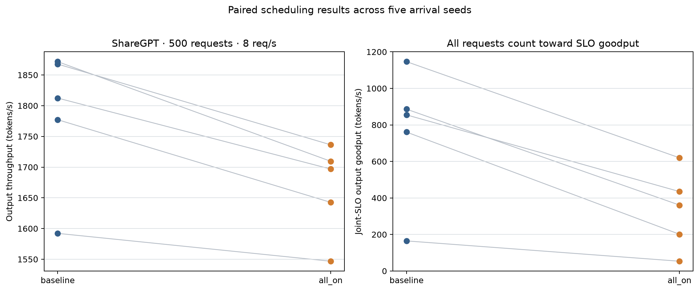

seed0 单因素筛查中，关闭 TPOT-aware 后输出吞吐从 1556.3 升至 1592.9 token/s，联合 SLO goodput 从 69.1 升至 88.3 token/s；这是单次筛查，仍低于同 seed 的独立 baseline 配对结果，不能据此定默认策略。

## 准入

共整理 21 行 500 请求完整 trace 数据。24 req/s 下，admission-off 与当前 cache-aware 策略如下：
20%/50% 共享前缀变体使用合成的 256-token 公共模板，不代表真实 system prompt。

| 共享前缀请求比例 | admission-off 接收 | admission-off 联合 goodput (token/s) | cache-aware 接收 / 拒绝率 | cache-aware 联合 goodput (token/s) |
|---:|---:|---:|---:|---:|
| 0% | 500/500 | 4823 | 331/500 (33.8%) | 3610 |
| 20% | 500/500 | 4713 | 402/500 (19.6%) | 4357 |
| 50% | 500/500 | 4632 | 208/500 (58.4%) | 2276 |

无共享前缀负载的高到达率筛查（接收率 / 联合 SLO 输出 goodput）：

| 到达率 (req/s) | admission-off | cache-aware |
|---:|---:|---:|
| 32 | 96.6% / 5161 | 40.2% / 2789 |
| 48 | 80.6% / 5276 | 55.0% / 4573 |
| 64 | 72.0% / 5291 | 48.2% / 4699 |
| 96 | 63.8% / 5253 | 28.8% / 4064 |

第一阶段包含 12 个 cache-aware target/work 组合；使用 400 条 calibration 请求、96 req/s、TTFT≤2000 ms、TPOT≤20 ms（单 seed）。
| target TTFT (ms) | work budget (ms) | cache-aware 拒绝率 | cache-aware 联合 goodput | cache-blind 联合 goodput | admission-off 联合 goodput | cache-aware TTFT p99 (ms) | cache-aware TPOT p99 (ms) |
|---:|---:|---:|---:|---:|---:|---:|---:|
| 500 | 2000 | 94.0% | 1013 | 1096 | 0 | 1942 | 7.1 |
| 500 | 5000 | 65.5% | 4237 | 4297 | 0 | 1048 | 18.2 |
| 500 | 10000 | 59.5% | 3918 | 3671 | 0 | 1024 | 21.3 |
| 1000 | 2000 | 95.2% | 936 | 1456 | 0 | 1908 | 7.6 |
| 1000 | 5000 | 66.0% | 4173 | 4339 | 0 | 1015 | 18.2 |
| 1000 | 10000 | 57.5% | 3578 | 4350 | 0 | 1107 | 21.8 |
| 2000 | 2000 | 94.2% | 945 | 755 | 0 | 1854 | 6.9 |
| 2000 | 5000 | 71.8% | 3787 | 4232 | 0 | 1058 | 18.7 |
| 2000 | 10000 | 57.5% | 3752 | 4706 | 0 | 1063 | 22.0 |
| 3000 | 2000 | 93.5% | 1147 | 1159 | 0 | 1955 | 6.7 |
| 3000 | 5000 | 65.5% | 4229 | 4324 | 0 | 1016 | 18.4 |
| 3000 | 10000 | 61.0% | 1824 | 3398 | 0 | 987 | 24.2 |
seed 0 网格中联合 goodput 最高的探索点为 target=500 ms、work=5000 ms，拒绝率 65.5%、goodput 4237 token/s。
100 条 smoke 子集在 96 req/s 下三种变体都接收了全部请求，因此没有用于参数选择。
第二阶段围绕首轮的高-goodput组和低拒绝率组，使用 TPOT≤80 ms 对 soft pressure / max wait 做 24 点筛查。该阶段与 TPOT≤20 ms 的 target/work 网格属于不同 SLO，不能合并成同一条 Pareto 曲线。
| target | work budget | soft pressure | max wait (ms) | 拒绝率 | 联合 goodput (token/s) | TTFT p99 (ms) | TPOT p99 (ms) |
|---:|---:|---:|---:|---:|---:|---:|---:|
| 500 | 5000 | 0.50 | 500 | 68.0% | 3860 | 549 | 15.3 |
| 500 | 5000 | 0.50 | 2000 | 81.2% | 3007 | 1525 | 11.0 |
| 500 | 5000 | 0.50 | 5000 | 88.8% | 1855 | 4806 | 11.7 |
| 500 | 5000 | 0.70 | 500 | 63.0% | 4516 | 567 | 19.5 |
| 500 | 5000 | 0.70 | 2000 | 72.5% | 3817 | 1036 | 17.5 |
| 500 | 5000 | 0.70 | 5000 | 82.0% | 2985 | 4939 | 15.3 |
| 500 | 5000 | 0.85 | 500 | 59.5% | 4629 | 556 | 23.3 |
| 500 | 5000 | 0.85 | 2000 | 67.5% | 4153 | 973 | 18.0 |
| 500 | 5000 | 0.85 | 5000 | 75.5% | 3866 | 946 | 18.4 |
| 500 | 5000 | 1.00 | 500 | 53.5% | 4802 | 554 | 24.5 |
| 500 | 5000 | 1.00 | 2000 | 58.8% | 4635 | 1008 | 21.7 |
| 500 | 5000 | 1.00 | 5000 | 66.5% | 4158 | 1007 | 22.2 |
| 2000 | 10000 | 0.50 | 500 | 72.8% | 3957 | 550 | 16.3 |
| 2000 | 10000 | 0.50 | 2000 | 74.8% | 3748 | 1188 | 14.7 |
| 2000 | 10000 | 0.50 | 5000 | 79.2% | 2833 | 5012 | 15.2 |
| 2000 | 10000 | 0.70 | 500 | 64.2% | 4398 | 555 | 19.7 |
| 2000 | 10000 | 0.70 | 2000 | 64.5% | 4370 | 1033 | 18.7 |
| 2000 | 10000 | 0.70 | 5000 | 74.0% | 4091 | 935 | 18.7 |
| 2000 | 10000 | 0.85 | 500 | 59.8% | 4598 | 550 | 23.1 |
| 2000 | 10000 | 0.85 | 2000 | 57.0% | 4762 | 1075 | 21.2 |
| 2000 | 10000 | 0.85 | 5000 | 68.0% | 4301 | 1025 | 22.5 |
| 2000 | 10000 | 1.00 | 500 | 54.0% | 4710 | 568 | 26.9 |
| 2000 | 10000 | 1.00 | 2000 | 54.2% | 4569 | 954 | 26.2 |
| 2000 | 10000 | 1.00 | 5000 | 64.8% | 4371 | 208 | 27.4 |
TPOT≤80 ms 的 seed 0 细化最高 goodput 点为 target/work/soft/wait=500/5000/1.00/500，拒绝率 53.5%、goodput 4802 token/s；该点同时是本轮 refinement 的最低拒绝率点（53.5%），仍是单次筛查结果。
配对验证按同一 prompt/arrival fingerprint 汇总 seed 间差值；括号内为均值 bootstrap 95% CI：

| 数据集 / 条件 | target/work/soft/wait | seeds (fingerprint 匹配) | admission-off 拒绝率 / goodput | cache-aware 拒绝率 / goodput | Δ goodput (token/s) mean (95% CI) | Δ reject (百分点) mean | cache-aware TTFT p99 median (ms) |
|---|---|---:|---:|---:|---:|---:|---:|
| calibration (400 req, 96 req/s, TPOT≤20 ms) | 500/5000/1.00/500 | 3 (3/3 fp) | 33.5% / 0 | 58.5% / 1607 | +1376 (+840 to +1681) | +25.1 pp | 565 |
| calibration (400 req, 96 req/s, TPOT≤40 ms) | 500/5000/1.00/500 | 3 (3/3 fp) | 33.2% / 5434 | 59.5% / 4520 | -975 (-1095 to -744) | +24.9 pp | 574 |
| calibration (400 req, 96 req/s, TPOT≤80 ms) | 500/5000/1.00/500 | 3 (3/3 fp) | 33.8% / 5217 | 58.2% / 4458 | -803 (-974 to -677) | +25.6 pp | 564 |
| calibration (400 req, 96 req/s, TPOT≤80 ms) | 2000/10000/1.00/500 | 3 (3/3 fp) | 33.5% / 5325 | 57.5% / 4553 | -660 (-861 to -315) | +23.1 pp | 570 |
| calibration (400 req, 96 req/s, TPOT≤120 ms) | 500/5000/1.00/500 | 3 (3/3 fp) | 33.8% / 5446 | 58.0% / 4410 | -974 (-1180 to -679) | +24.8 pp | 561 |
| held-out (100 req, 384 req/s, TPOT≤80 ms) | 500/5000/1.00/500 | 2 (2/2 fp) | 0.0% / 4507 | 16.5% / 3774 | -734 (-804 to -663) | +16.5 pp | 548 |
| held-out (100 req, 384 req/s, TPOT≤80 ms) | 2000/10000/1.00/500 | 2 (2/2 fp) | 0.0% / 4288 | 0.0% / 4311 | +23 (-298 to +344) | +0.0 pp | 395 |
没有业务拒绝率预算；即使某个网格点提高了联合 goodput，也只作为可选 operating point，不据此推荐新的默认阈值。
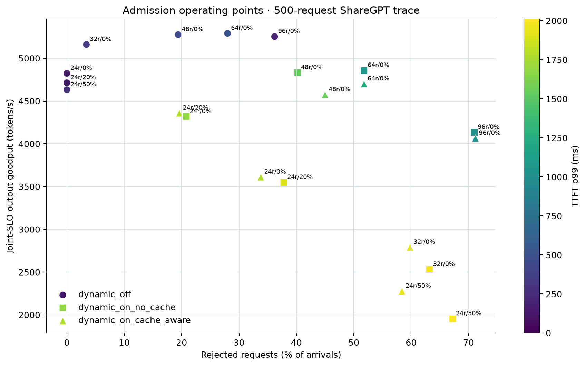
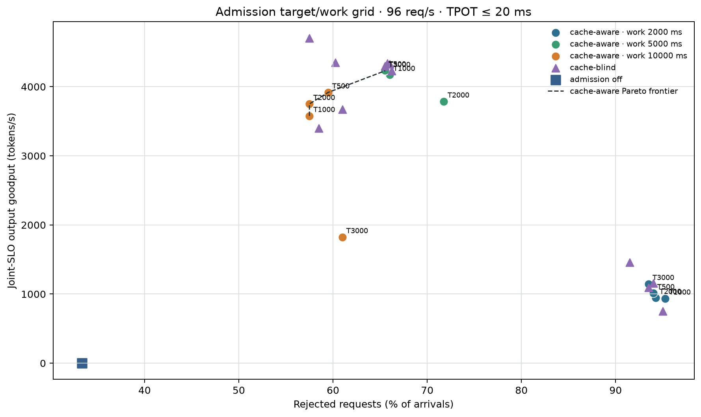
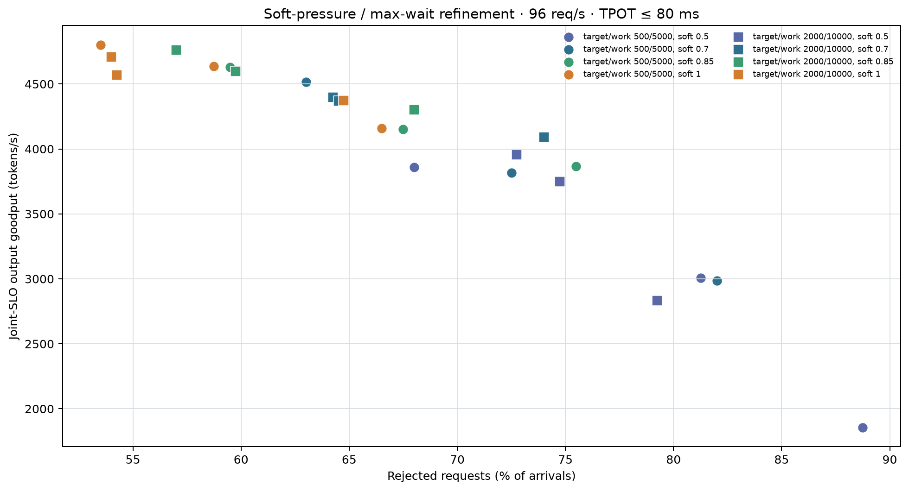

## KV 容量与 FP8 精度

BF16 synthetic 矩阵报告 425 个 block、108800 个 token slot；按 pool 容量 / context length 折算的完整上下文请求数为 512 tokens: 141 requests, 1024 tokens: 85 requests, 2048 tokens: 47 requests, 4096 tokens: 25 requests。FP8 E4M3 矩阵报告 835 个 block、213760 个 slot；同口径折算数为 2048 tokens: 92 requests, 4096 tokens: 49 requests。这不是在线并发或 SLO 保证。真实 ShareGPT prompt 矩阵有 9 行，pool 为 423 个 block / 108288 个 slot。
4096-token、48/64 并发的原始 swap-on 点累计 swap=0，未触发 offload。另在 4096 输入、32 并发、512 输出的压力诊断中，关闭重算成本比较后完成 3 次重复；swap-on 的吞吐变化相对 no-swap 为 -8.07%。这只验证了 swap 路径，不表示该路径提升服务性能。默认成本策略诊断点发生 2 次抢占，其中重算 2 次、swap 0 次。
| 抢占设置 | 输出 tok/s | TTFT p99 (ms) | TPOT p99 (ms) | 抢占 | swap | 重算 |
|---|---:|---:|---:|---:|---:|---:|
| swap on; cost comparison off | 470.2 | 28859 | 61.4 | 18 | 12 | 6 |
| swap off; cost comparison off | 511.4 | 24912 | 53.6 | 6 | 0 | 6 |
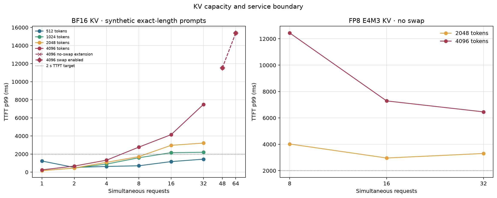

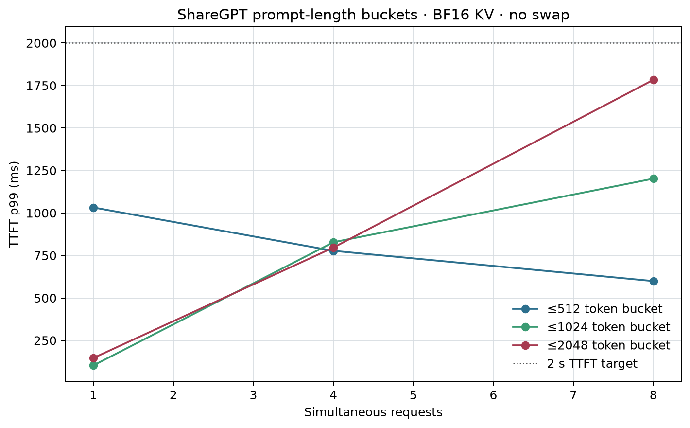

FP8 校准使用 32 条 prompt / 4332 tokens；held-out 检查使用 16 条 / 691 tokens。下表中的 logits 指标基于首个 decode 位置；样本量较小，不代表长文本生成质量。

| scale margin | 首 token 一致率 | logits top-1 一致率 | top-5 overlap | KL(ref‖FP8) | 最大范围利用率 | 超 E4M3 limit 组件数 |
|---:|---:|---:|---:|---:|---:|---:|
| 0.90 | 100.0% | 100.0% | 92.5% | 0.00991 | 1.348 | 48 |
| 1.00 | 100.0% | 93.8% | 93.8% | 0.00506 | 1.214 | 8 |
| 1.10 | 100.0% | 93.8% | 96.3% | 0.00551 | 1.103 | 3 |
| 1.25 | 100.0% | 93.8% | 97.5% | 0.00588 | 0.971 | 0 |

## INT4 MoE

1/4/16/64/128 行微基准中，fused segment 相对 expert loop 的 median speedup 为 11.90× 到 42.95×。固定输入正确性覆盖 26 层、260 个 layer×seed×batch case；split 精确匹配 260/260，fused 精确匹配 260/260。微基准收益不等同于 serving 收益。
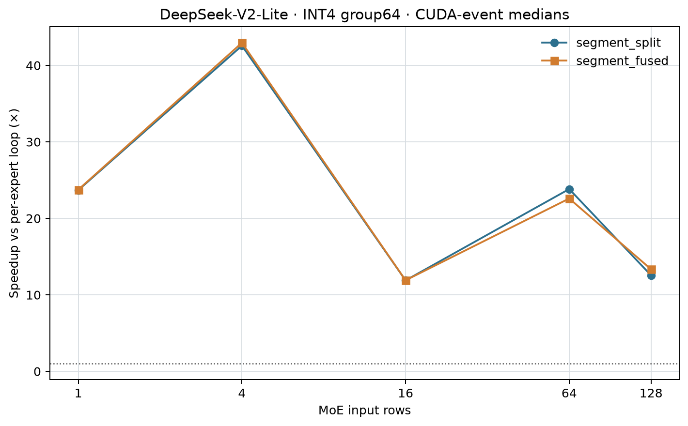

ShareGPT prompt 在线 sweep 的初始筛查有 36 个配对条件：fused 输出吞吐 median delta +0.91%（范围 -14.94% 至 +23.07%；20 胜 / 16 负）。所有请求输出完全匹配的配对为 19/36；联合 SLO goodput 百分比的可计算配对 median 为 -5.46%。
针对 8 req/s、16 请求、128 输出、100 ms TPOT 条件补做 25 组配对重复（5 seeds × 5 repeats）：吞吐中位差 0.51%（范围 -12.87% 至 16.46%；14 胜 / 11 负），均值 95% bootstrap CI -0.35% 至 5.11%；联合 SLO goodput 差值中位 10.35 token/s；输出 token 完全匹配 14/25。单一在线条件仍不证明稳定融合收益，内核正确性以固定输入 layer 检查为准。
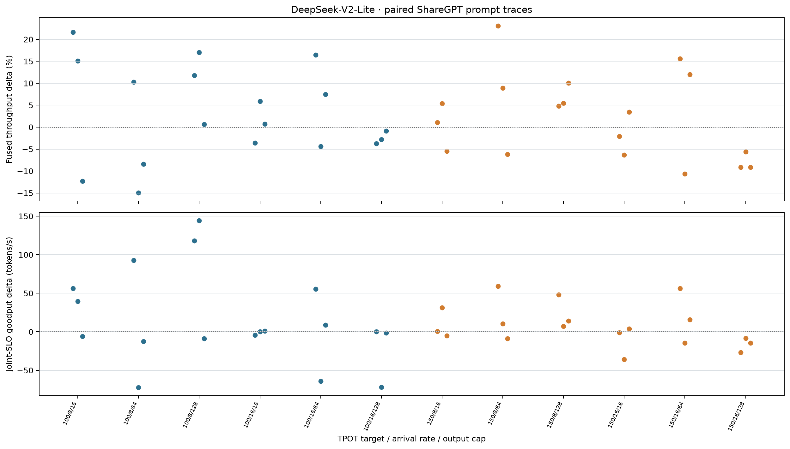

MLA cache assembly 同时修正了 query range 计算：每行结束位置使用 `start + qlen`，并检查 query start/length 数量与 row 数一致。修正后 seed42 的 16 请求复现记录仍有 1 个请求输出不一致（request 5，0-based token 14；15/16 请求匹配），因此根因尚未完整关闭；不要把该修正描述为已解决所有在线分歧。

## 投机解码

N-gram 共 51 条运行记录。batch=8、γ=4 的内容分层中位数：

| 类别 | 运行数 | α median | 吞吐 speedup median |
|---|---:|---:|---:|
| json | 3 | 0.213 | 1.302× |
| open_ended | 3 | 0.180 | 1.599× |
| repeat | 3 | 0.997 | 4.584× |
| sharegpt | 3 | 0.154 | 1.513× |
| structured | 3 | 0.142 | 1.302× |

free / repeat 的 batch×γ 扩展：

| 类别 | 运行数 | α median | 吞吐 speedup median |
|---|---:|---:|---:|
| free | 18 | 0.602 | 1.215× |
| repeat | 18 | 0.993 | 2.799× |

混合这些运行的 α 与输出 4-gram 重复率 Spearman ρ=0.929，与 distinct-4 ρ=-0.929。相关性跨多个类别和 batch，不是因果或总体服务估计。repeat 对照 α 接近 1，真实对话及结构化内容更低且波动；没有可用的 Medusa/EAGLE draft 权重。
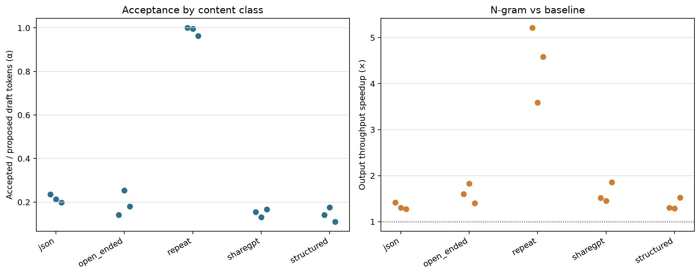

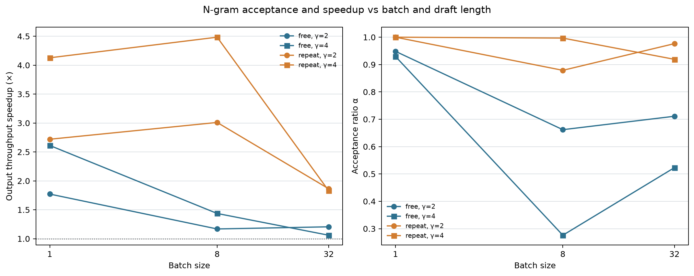

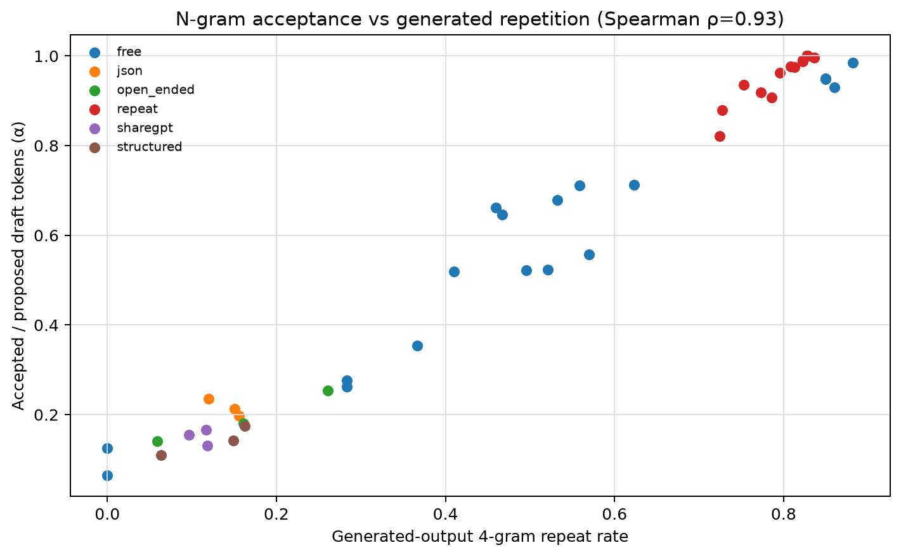

## 未覆盖项与解释边界

- 准入：已做 TPOT 20 ms 的 12 点 target/work 网格、TPOT 80 ms 的 24 点 soft/wait 网格，以及 20/40/80/120 ms 下的候选 seed 对照和 100 条 held-out prompt。target/work 与 refinement 使用不同 TPOT SLO；held-out 使用 384 req/s 短 trace，与 400 请求 calibration 负载不等价。没有产品拒绝率预算，仍不推荐上线阈值。
- KV：默认成本策略压力点以重算处理了抢占；关闭重算成本比较后单独测了 swap on/off 三次，报告是 swap 路径诊断而非性能收益。未测到 OOM/物理容量极限；FP8 held-out 只比较少量 prompt 的首个 decode logits。
- INT4 MoE 在线初筛每条件一次，16 请求、8/16 req/s、16/64/128 输出上限、100/150 ms TPOT、3 seeds；另对 8 req/s、128 输出、100 ms TPOT 做 5 seeds × 5 repeats。仍不足以确认所有负载上的稳定 goodput 提升。
- 投机解码使用固定 96-token 输出、temperature 0.6、3 seeds 和 n-gram；没有自然停止、Medusa/EAGLE 权重或大规模 held-out workload。
- 性能实验运行于带未提交代码的工作区；以上数据只对应所列 GPU、模型、负载和配置。
